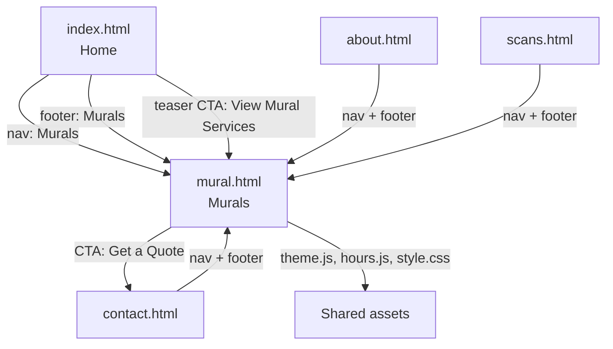

# Mural Services Page — Implementation Plan

## Overview

Create a new page (`mural.html`) for Tryjax's custom mural services. The page follows the exact pattern established by [`scans.html`](../scans.html) (shared header/hero/footer, alternating `bg-light` sections, `.services-grid` feature cards). The gallery section uses **colored placeholder tiles** (no real mural photos exist yet — no new image assets are created). The page is integrated into [`index.html`](../index.html) via a new nav link, a new footer link, and a teaser section, and the nav/footer links are added to **all five pages** for consistency.

**No model-viewer, no new JS, no new images.** Only one new HTML file, small additions to `style.css`, and link/teaser edits across the existing pages.

---

## 1. Content Plan

### Page Identity

| Property | Value |
|----------|-------|
| File | `mural.html` |
| `<title>` | `Custom Murals - Tryjax Construction` |
| Nav label | `Murals` |
| Footer nav label | `Murals` |

### Hero (Section 2)

- `<h1>Custom Murals</h1>`
- Subtitle: `Full turnkey wall graphics for commercial spaces — designed, printed, and installed by Tryjax.`

### Key Selling Points (Section 3) — heading: `Why Choose Tryjax Murals`

Three `.service-card` items in a `.services-grid` (identical structure to the Benefits section in [`scans.html:70`](../scans.html:70)):

| # | Card `<h3>` | Card `<p>` (copy to use) |
|---|-------------|---------------------------|
| 1 | `Full Turnkey Solution` | `In-house design, on-site measuring, quick turnaround, competitive bulk pricing, and on-site licensed and insured installation. One team handles your mural from concept to finished wall.` |
| 2 | `Commercial Grade & Safe` | `Our mural material is fire-rated and safe for commercial use, so your investment meets the safety and compliance standards your property requires.` |
| 3 | `Customizable Options` | `Produced in any design or shape, with various finishes available — including UV and reactive prints — so every mural matches your brand exactly.` |

### Gallery (Section 4) — heading: `Mural Gallery`

- Subtitle `<p>` (centered, `color: var(--text-secondary); margin-bottom: 30px;` inline style — same pattern as [`index.html:112`](../index.html:112) and [`index.html:107`](../about.html:107)): `A selection of our work. Full installation photography is coming soon.`
- **6 placeholder tiles** in a new `.mural-gallery` grid (approach below).
- Each tile contains a centered italic label: `Mural Photo Coming Soon`

### CTA (Section 5)

- `<h2>Ready to Bring Your Walls to Life?</h2>`
- `<p>Send us your space and your ideas — we will handle the design, the print, and the installation.</p>`
- `<a href="contact.html" class="btn">Get a Quote</a>`

(Same structure as the "Contact Us" CTA block in [`index.html:188`](../index.html:188).)

---

## 2. Page Structure — [`mural.html`](../mural.html)

| # | Section | ID/Class | Background |
|---|---------|----------|------------|
| 1 | Header | `<header>` | Shared header, includes new "Murals" nav link (see Section 3) |
| 2 | Hero | `#home.hero` | `h1` "Custom Murals" + subtitle paragraph (no CTA button — matches `scans.html`/`about.html` heroes) |
| 3 | Key Selling Points | `#features.section.bg-light` | `.services-grid` with the 3 `.service-card` items above |
| 4 | Gallery | `#gallery.section` | `.mural-gallery` grid with 6 `.mural-tile` placeholder divs |
| 5 | CTA | `#cta.section.bg-light` | Centered heading + paragraph + `.btn` → `contact.html` |
| 6 | Footer | `<footer>` | Shared footer, includes new "Murals" nav link |

**Head section** — copy exactly from [`about.html:3`](../about.html:3)–`about.html:11` (about/contact do **not** load model-viewer, which `mural.html` also does not need):

```html
<head>
    <meta charset="UTF-8">
    <meta name="viewport" content="width=device-width, initial-scale=1.0">
    <title>Custom Murals - Tryjax Construction</title>
    <link rel="stylesheet" href="style.css">
    <link rel="icon" type="image/x-icon" href="Images/Favicon.png">
    <meta name="theme-color" content="#ffffff" media="(prefers-color-scheme: light)">
    <meta name="theme-color" content="#1a1a2e" media="(prefers-color-scheme: dark)">
    <script src="theme.js"></script>
</head>
```

**Bottom of `<body>`** — before `</body>`, add `<script src="hours.js"></script>` (footer uses `#footer-business-hours` / `#footer-business-hours-note`, same as every other page).

**Full `#gallery` section HTML:**

```html
<!-- Mural Gallery Section -->
<section id="gallery" class="section">
    <div class="container">
        <h2>Mural Gallery</h2>
        <p style="text-align: center; color: var(--text-secondary); margin-bottom: 30px;">A selection of our work. Full installation photography is coming soon.</p>
        <div class="mural-gallery">
            <div class="mural-tile mural-tile-1"><span>Mural Photo Coming Soon</span></div>
            <div class="mural-tile mural-tile-2"><span>Mural Photo Coming Soon</span></div>
            <div class="mural-tile mural-tile-3"><span>Mural Photo Coming Soon</span></div>
            <div class="mural-tile mural-tile-4"><span>Mural Photo Coming Soon</span></div>
            <div class="mural-tile mural-tile-5"><span>Mural Photo Coming Soon</span></div>
            <div class="mural-tile mural-tile-6"><span>Mural Photo Coming Soon</span></div>
        </div>
    </div>
</section>
```

### Placeholder Approach (gallery)

- **Colored CSS gradient tiles — do NOT create image files.** Each tile is a `<div>` with a fixed height, rounded corners, card shadow, and a semi-transparent `linear-gradient` background. Semi-transparent hues (rgba with ~0.35–0.45 alpha) are deliberately used so the tiles look intentional in **both** light and dark themes without needing theme-scoped variables.
- The hover lift mirrors `.client-card:hover` / `.partner-logo:hover` (`transform: translateY(-5px)` + `--shadow-card-hover`).
- **Future swap:** when real photos exist, replace each `<div class="mural-tile mural-tile-N"><span>…</span></div>` with an `` and add a `.mural-gallery img` rule (or keep the tile div and put the `` inside it at `width: 100%; height: 100%; object-fit: cover;`). No other structural change needed.

---

## 3. Integration with [`index.html`](../index.html)

Three concrete edits (line numbers refer to the current file):

### 3.1 Header nav — insert after line 22

After the existing `<li><a href="scans.html">3D Imaging</a></li>` (line 22), add:

```html
<li><a href="mural.html">Murals</a></li>
```

Resulting nav order: **Home | About | 3D Imaging | Murals | Contact** (theme toggle stays last).

### 3.2 Footer nav — insert after line 204

After the existing `<li><a href="scans.html">3D Imaging</a></li>` (line 204), add:

```html
<li><a href="mural.html">Murals</a></li>
```

### 3.3 Teaser section — insert between line 107 and line 109

Insert a new section immediately after the closing `</section>` of the "What We Do" block (line 107) and before `<section id="coverage-area" class="section">` (line 109):

```html
<!-- Mural Services Teaser -->
<section class="section">
    <div class="container">
        <h2>Custom Murals</h2>
        <p style="text-align: center; color: var(--text-secondary); margin-bottom: 30px;">Full turnkey wall graphics — designed, printed, and installed in-house. Fire-rated, commercial-grade, and produced in any design or shape.</p>
        <a href="mural.html" class="btn">View Mural Services</a>
    </div>
</section>
```

This mirrors the site's existing centered-CTA blocks (model-viewer teaser at [`index.html:62`](../index.html:62) and the Contact Us block at [`index.html:188`](../index.html:188)) and the inline-styled subtitle pattern at [`index.html:112`](../index.html:112).

### 3.4 Nav + footer link in the other pages (consistency)

Apply the **same two edits** (insert `<li><a href="mural.html">Murals</a></li>` after the "3D Imaging" li in the header nav, and after the "3D Imaging" li in the footer nav) to:

| File | Header nav insert after | Footer nav insert after |
|------|-------------------------|--------------------------|
| [`about.html`](../about.html) | line 21 | line 105 |
| [`contact.html`](../contact.html) | line 21 | line 105 |
| [`scans.html`](../scans.html) | line 22 | line 156 |
| `mural.html` (new) | built in from the start | built in from the start |

The shared header/footer blocks in the new page must match the other pages **exactly** (including the MoonIcon theme toggle markup at [`index.html:24`](../index.html:24)).

---

## 4. CSS Changes — [`style.css`](../style.css)

### 4.1 Conventions to follow

- Kebab-case, noun-based class names (`.services-grid`, `.client-card`, `.partner-showcase`) → `.mural-gallery`, `.mural-tile`.
- **No hardcoded colors in rules** — reference `var(--*)` properties. The only colors introduced are the semi-transparent placeholder gradients (decorative, theme-agnostic by design, as documented above); everything else uses existing variables (`--shadow-card`, `--shadow-card-hover`, `--text-secondary`).
- Section comment header in the same `/* ===== … ===== */` style as the rest of the file.
- Grid pattern mirrors `.services-grid` (auto-fit `minmax`), so **no new media query is required** — tiles reflow at 768px automatically.

### 4.2 Exact CSS to append at the END of `style.css` (after the Alternating Image-Text responsive block, currently the last rule at line ~963)

```css
/* ===== Mural Gallery Section ===== */

.mural-gallery {
    display: grid;
    grid-template-columns: repeat(auto-fit, minmax(280px, 1fr));
    gap: 20px;
}

.mural-tile {
    height: 220px;
    border-radius: 8px;
    box-shadow: var(--shadow-card);
    display: flex;
    align-items: center;
    justify-content: center;
    padding: 10px;
    transition: transform 0.3s ease, box-shadow 0.3s ease;
}

.mural-tile span {
    color: var(--text-secondary);
    font-size: 14px;
    font-style: italic;
    text-align: center;
}

.mural-tile:hover {
    transform: translateY(-5px);
    box-shadow: var(--shadow-card-hover);
}

/* Distinct placeholder gradients — semi-transparent so they read in both themes */
.mural-tile-1 { background: linear-gradient(135deg, rgba(230, 126, 34, 0.45), rgba(142, 68, 173, 0.35)); }
.mural-tile-2 { background: linear-gradient(135deg, rgba(52, 152, 219, 0.45), rgba(26, 188, 156, 0.35)); }
.mural-tile-3 { background: linear-gradient(135deg, rgba(231, 76, 60, 0.40), rgba(230, 126, 34, 0.35)); }
.mural-tile-4 { background: linear-gradient(135deg, rgba(142, 68, 173, 0.40), rgba(52, 73, 94, 0.40)); }
.mural-tile-5 { background: linear-gradient(135deg, rgba(26, 188, 156, 0.40), rgba(41, 128, 185, 0.35)); }
.mural-tile-6 { background: linear-gradient(135deg, rgba(241, 196, 15, 0.40), rgba(230, 126, 34, 0.35)); }
```

No changes to `:root` / `[data-theme="dark"]` variable blocks are required.

---

## 5. Implementation Checklist

| # | File | Action | Details |
|---|------|--------|---------|
| 1 | `mural.html` | **Create** | Full page per Section 2: head (no model-viewer), header with 5 nav links, hero, `#features` (3 service cards), `#gallery` (6 tiles), `#cta`, footer with 5 nav links, `hours.js` script tag |
| 2 | `style.css` | **Modify** | Append the Mural Gallery CSS block from Section 4.2 at the end of the file |
| 3 | `index.html` | **Modify** | (a) Header nav: add Murals li after line 22; (b) footer nav: add Murals li after line 204; (c) insert teaser section between lines 107 and 109 (Section 3.3) |
| 4 | `about.html` | **Modify** | Header nav: add Murals li after line 21; footer nav: add Murals li after line 105 |
| 5 | `contact.html` | **Modify** | Header nav: add Murals li after line 21; footer nav: add Murals li after line 105 |
| 6 | `scans.html` | **Modify** | Header nav: add Murals li after line 22; footer nav: add Murals li after line 156 |
| 7 | `plans/site-documentation.md` | **Modify** | Documentation updates listed in Section 6 |
| 8 | — | **Verify** | Open `mural.html` in light + dark mode (toggle works, tiles readable, no console errors); open at ≤768px (tiles reflow, hero 300px, footer stacks); confirm all nav/footer links resolve on every page; confirm `index.html` teaser links to `mural.html` |

**Files touched:** `mural.html` (new), `style.css`, `index.html`, `about.html`, `contact.html`, `scans.html`, `plans/site-documentation.md`. **No other files change.**

---

## 6. Documentation Update Notes — `plans/site-documentation.md`

After implementation, update the following parts of [`plans/site-documentation.md`](site-documentation.md):

1. **§1 Project Overview table** — Pages row: `4` → `5`, list `mural.html` in the page list.
2. **§1 Directory Structure** — add a `mural.html` line with comment `# Murals page (hero, feature cards, placeholder gallery, CTA)`.
3. **§2 Page Reference** — add new **§2.5 [`mural.html`](../mural.html) — Mural Services Page** with the section table from Section 2 of this plan (title `Custom Murals - Tryjax Construction`; note it does **not** load model-viewer; note gallery tiles are placeholders).
4. **§3.1 Header** — add `<li><a href="mural.html">Murals</a></li>` to the nav code sample; update nav order to Home, About, 3D Imaging, Murals, Contact.
5. **§3.2 Footer** — add the Murals link to the footer nav code sample.
6. **§3.3 Hero "Scope" note** — add `mural.html` to the page list that shares `#home`.
7. **§4.3 Layout Classes** — add rows for `.mural-gallery` (auto-fit grid, `minmax(280px, 1fr)`, gap 20px) and `.mural-tile` (fixed 220px height placeholder tile with hover lift).
8. **§12 Quick Reference — All CSS Classes** — add `.mural-gallery`, `.mural-tile`, `.mural-tile-1` … `.mural-tile-6` (placeholder gradient variants).
9. **§11 Architecture Diagram (mermaid)** — add a `M[mural.html<br/>Murals]` node in the Pages subgraph with edges `M --> E`, `M --> F`, `M --> J`, `M --> G`; update the Header subgraph nav label to `Nav Links: Home, About, 3D Imaging, Murals, Contact`; add `H2 -.-> M`.
10. **§8 Browser Meta Tags** — no change needed (mural.html includes the same two `theme-color` metas).

---

## 7. Site Map After Implementation


